# Networkwalks-B084-week3-Password-Cracking-JTR-NW
Password Cracking with JTR and Networkwalks Tools

**W3-PM  |  CYBERSECURITY  |  NETWORKWALKS**

| Field | Detail |
|---|---|
| **Pentester Name (Cybersecurity Professional)** | **Ebenezer Twumasi Frimpong** |
| **Program/Batch** | B084-Networkwalks |
| **Date** | 16 November 2026 |
| **Modules completed** | W3-PM1 (Password Cracking with John The Ripper) W2-PM5 (Password Cracking with Networkwalks Tools) |
| **Client/Target** | 3 Encrypted/Password-protected Files |
| **Permission secured from client?** | Yes |

---

# 1. ⚠️Liability Disclaimer

I have performed these activities only on the systems & devices where I had secured written permission or the devices/systems that I own myself. All these materials are for education and research purpose only. Do not use anything from here to break the law. The instructor, the authors and Networkwalks are not responsible for what you do with this knowledge. Every action you take is your own responsibility. Misuse can lead to criminal charges, heavy fines, loss of your job and a permanent record. In most countries unauthorised access is a crime even when nothing is damaged.

---

# 2. 🛡️Introduction

This project involves understanding password cracking, password hashes and password security through two practical exercises. The activities are as follows:

1. Password cracking with John the Ripper (JTR).
2. Password cracking using Networkwalks (NW) tools.

These practicals were performed in a controlled lab environment using password-protected PDF files.

---

# 3. 🎯Objectives

The main objectives of this project are to:

- Download and install JTR and Johnny on Windows.
- Find the hashes of the locked pdf files using `onlinehashcrack.com` website.
- Use the password tools in JTR to crack the password of the files.
- Use Networkwalks Hash Calculator to also find the hashes of the locked pdf files.
- Use Networkwalks Password Cracker to crack the password.

---

# 4. 🔗Tools Used

The table below lists each tool used in this project and its purpose.

| Tool | Purpose |
|---|---|
| Windows              | Operating systems used for project.                                       |
| Johnny app           | GUI of JTR.                                                               |
| John.exe             | Attached to JTR to enable cracking.                                       |
| onlinehashcrack.com  | Online website used to calculate the hash values of the files.            |
| Networkwalks Tools   | 2 separate tools (NW Calculator and Cracker) used for cracking passwords. |

---

# 5. 🪜Activities Performed

## 5.1 Password Cracking with JTR

John the Ripper (JTR) is a popular password cracking tool used by security professionals to test how strong passwords are. It started as a tool for Unix systems but now works on Windows, Linux and Mac. It can check many types of password hashes and also unlock password protected files like PDF, ZIP and Office documents. Johnny is the graphical version of John the Ripper. It gives a simple point and click screen, so beginners can use JTR without typing long commands. Both tools are widely used in security testing and learning labs to understand password safety. The following are the steps followed to crack the password-protected files:

1. Download and install JTR and Johnny GUI on Windows.
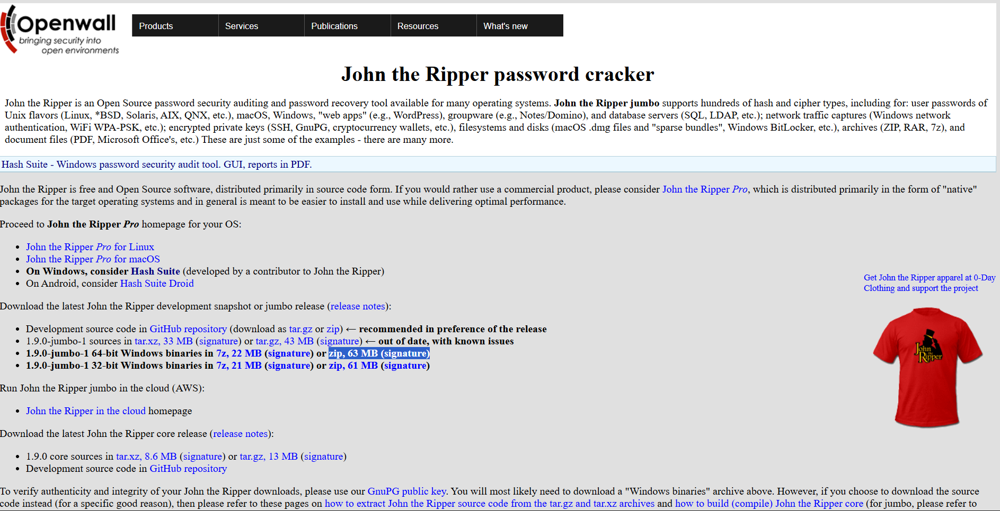
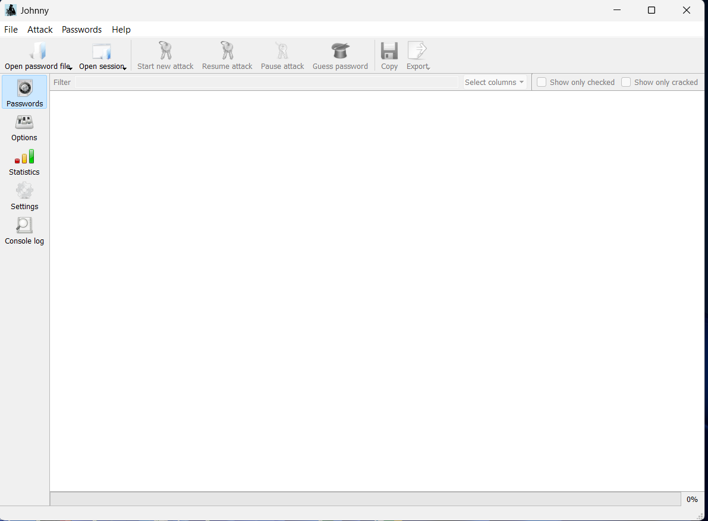

2. Extract JTR download and attach the john.exe extension file (john-1.9.0-jumbo-1-win64--john-1.9.0-jumbo-1-win64--run--john.exe) and add it to the Johnny GUI.
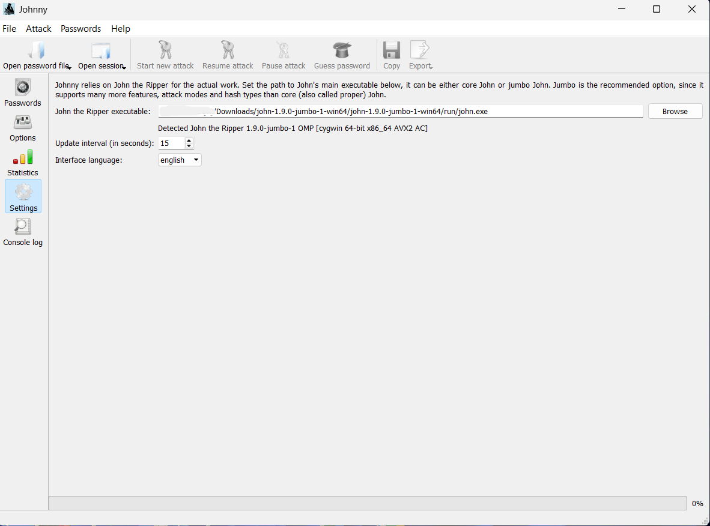

3. Upload the locked PDF file on the `onlinehashcracker.com` website to calculate the hash of the file.
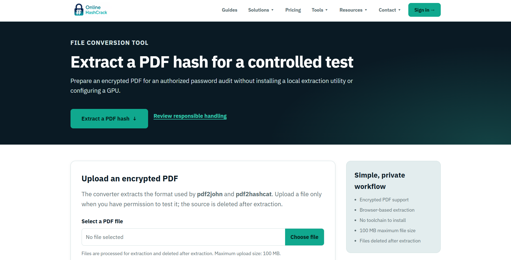
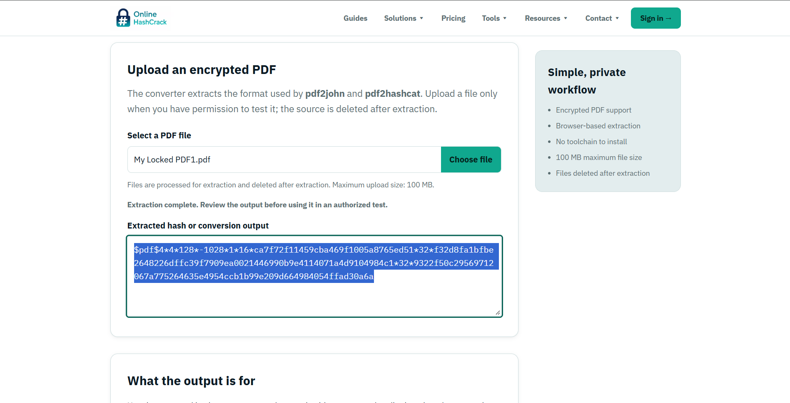

4. Save the calculated hash in a text file.
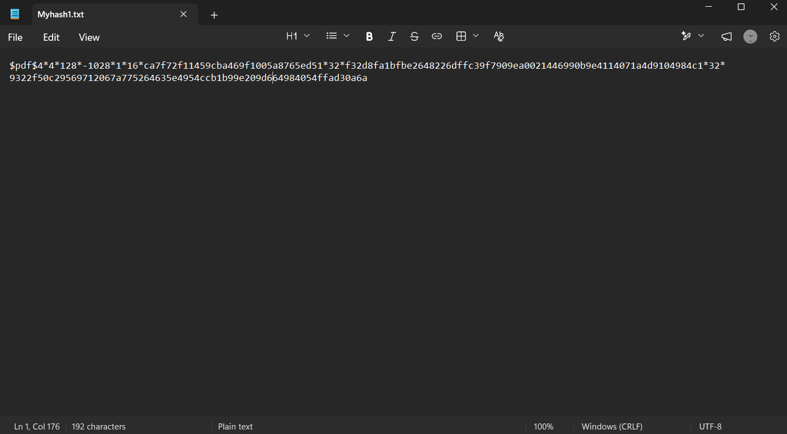

5. Upload the saved .txt file to the Johnny GUI and **Start new attack**. This will crack the pdf file based on the computer speed and password complexity. For this file the password was "good-luck".
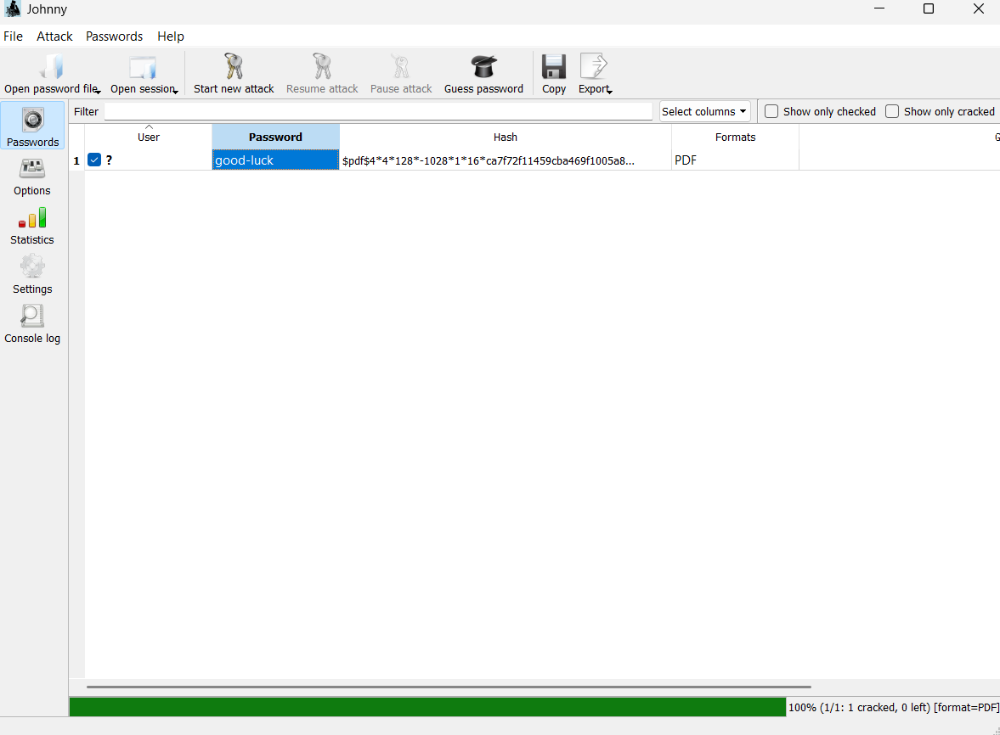

The cracked password can now be used to open the file as shown below:

## 5.2 Password Cracking with Networkwalks Tools

This task employed the use of 2 NW tools to perform the same password cracking. These tools, Hash Calculator and Password Cracker are free online tools that runs in a web browser. The following are the steps followed to crack the password-protected files:

1. Open the Hash Calculator in any web browser with the link `https://networkwalks.com/hash-calculator/`.
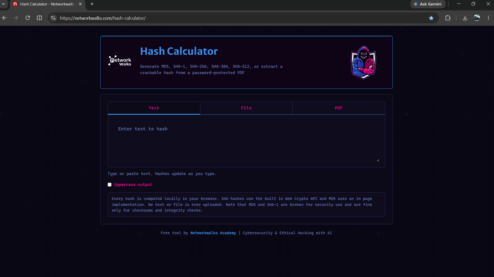

2. Upload the encrypted file into the pdf section of the website and copy the hash calculated hash. There is also an available option to download the calculated hash into a .txt file.
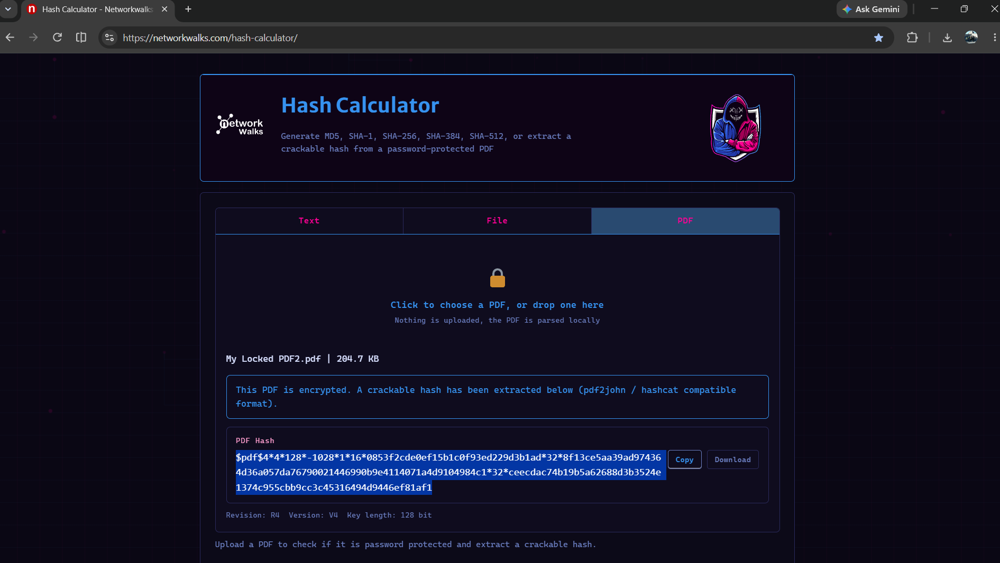

3. Open the Password Cracker in any web browser with the link `https://networkwalks.com/password-cracker/` and paste the hash to start cracking. There is again an option to upload one's own built directory or customised password file should NW default password-cracker be unsuccessful. For this file the password was "password1"
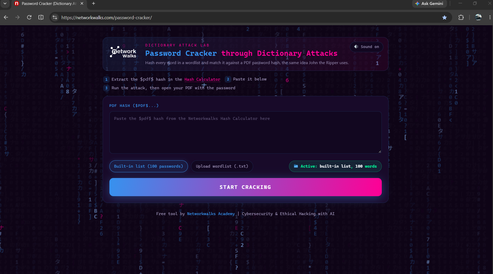
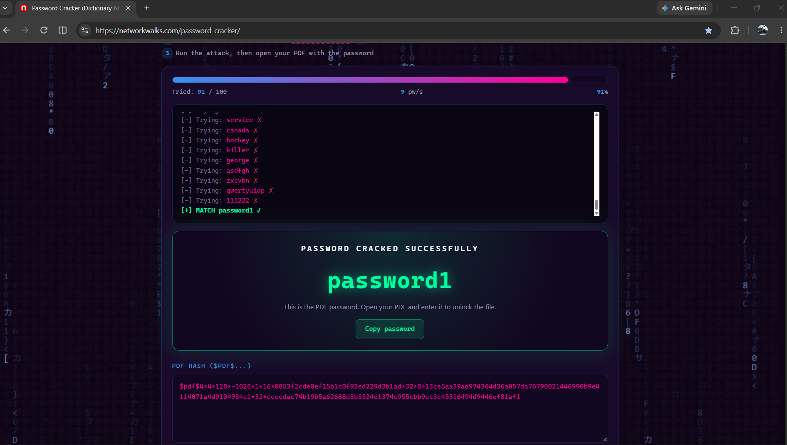

The cracked password can now be used to open the file as shown below:
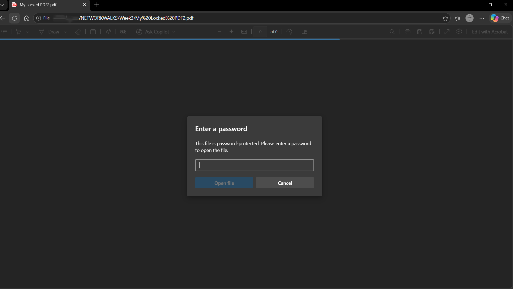
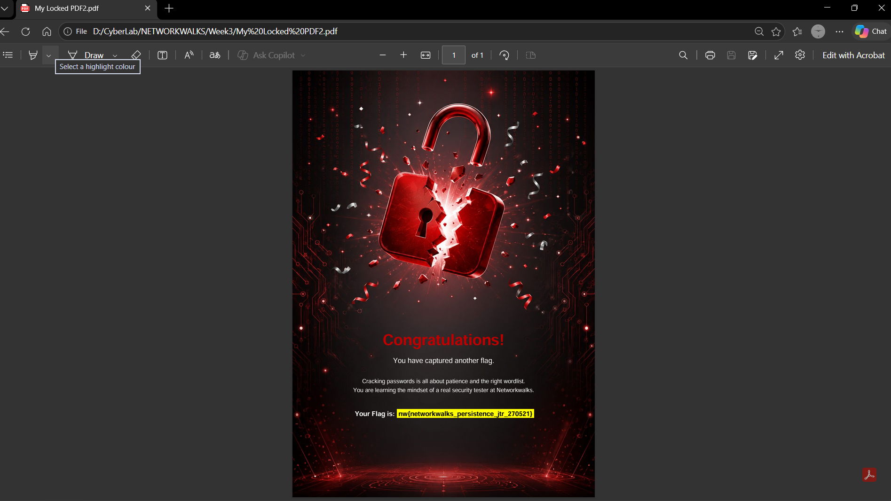

---

# 6. 💡Lessons Learnt

The following are some of the lessons learnt in this project:

1. **Understanding the importance of strong passwords:** Always use long, unique passwords rather than simple or predictable ones as simple passwords can be guessed relatively quickly.

2. **Understanding encryption and password protection:** Strong encryption should be combined with strong passwords to provide effective data protection.

3. **Understanding the role of password hashes:** Password security depends not only on password complexity but also on how passwords and encryption keys are handled as JTR generally works by comparing password hashes.

4. **Understanding the limitations of password-cracking tools:** A password that cannot be cracked within a short period is not necessarily impossible to crack. It may simply require more time or computational resources.

---

# 7. 🏅Conclusion

Through this practical exercise, I learned how John the Ripper can be used to assess the security of password-protected pdf documents. I gained a better understanding of password-cracking techniques such as dictionary attacks and the importance of password complexity and encryption. The exercise demonstrated that weak and predictable passwords can expose confidential information to unauthorized access. It also helped me develop practical skills in understanding how password recovery mechanisms work.

Most importantly, I learned that effective information security requires strong passwords, reliable encryption mechanisms and responsible security practices. Password-cracking tools should only be used for authorized testing and legitimate recovery purposes.

---

# 🔗 Tools & Resources

- **John the Ripper:** [https://https://www.openwall.com/john](https://https://www.openwall.com/john)
- **Johnny GUI** [https://openwall.info/wiki/john/johnny](https://openwall.info/wiki/john/johnny)
- **OnlineHackCrack:** [https://onlinehashcrack.com/tools-pdf-hash-extractor.php](https://onlinehashcrack.com/tools-pdf-hash-extractor.php)
- **NW Hash Calculator:** [https://networkwalks.com/hash-calculator](https://networkwalks.com/hash-calculator)
- **NW Password Cracker:** [https://networkwalks.com/password-cracker](https://networkwalks/password-cracker)

---

# 👤 Author

**Ebenezer Twumasi Frimpong**\
Cybersecurity Intern B084

LinkedIn: [https://linkedin.com/in.ebenezer-twumasi-frimpong-0689143b8/](https://www.linkedin.com/in/ebenezer-twumasi-frimpong-0689143b8/)

---

## 📌 Project Information

**Program Name:** Cybersecurity at Networkwalks | **Week:** 03 | **Project:** Password Cracking with JTR & NW Tools | **Repository:** GitHub
